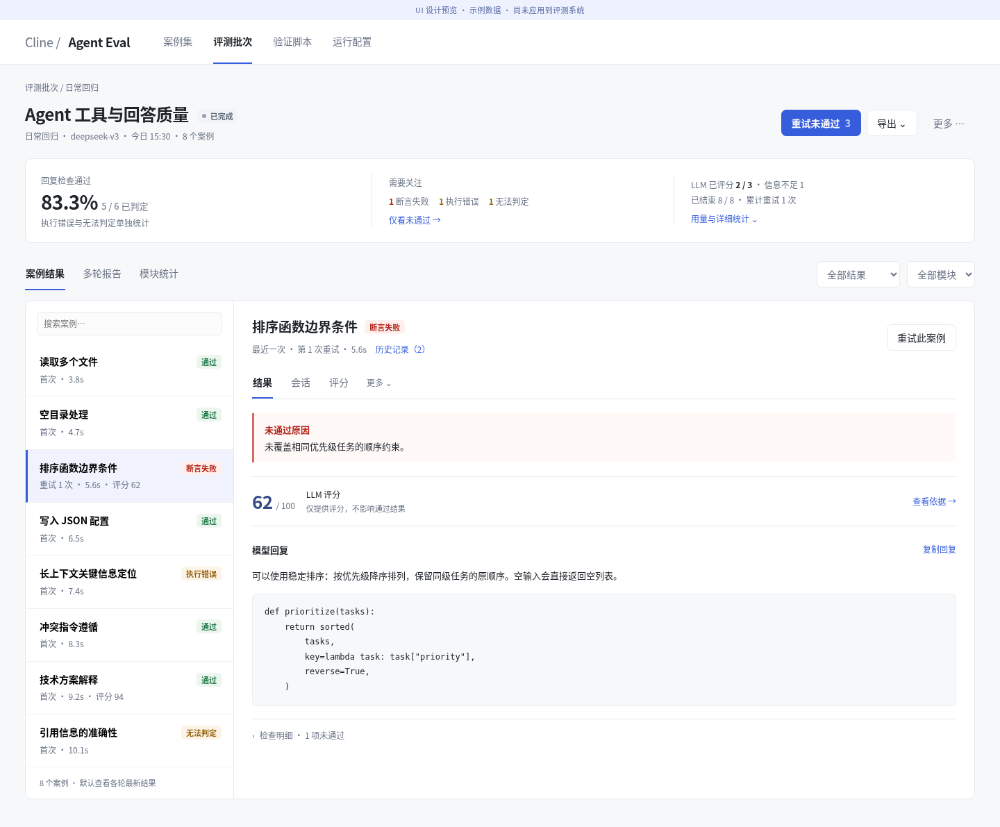

# SPEC-027：新功能界面的层级、操作与视觉统一

状态：Implemented
日期：2026-10-26（北京时间）
基线：`work`，`d7236fd`（SPEC-026 性能优化已推送）
提出依据：用户要求 review 新功能 UI，让使用更加简洁、直观、有品味。
范围：agent-eval Web 的案例集、案例编辑、新建评测、批次结果、重试、复制、LLM Judge 配置/结果/试评分及全局设置；统一公共样式与交互组件。只调整呈现、前端交互及按需加载入口，不修改 SDK、数据库合同、模型调用/判分语义或增加独立业务能力。
确认状态：用户查看设计稿截图后于 2026-10-26 明确要求“继续实施”，批准本方案全部范围。

## 1. 目标与设计方向

让用户进入页面后清楚看到：当前在做什么、结果如何、下一步能做什么。日常操作保留直接入口，诊断和高级配置按需展开，技术信息完整可达。

采用克制的浅色工作台风格：白色内容面、浅灰背景、统一蓝色主操作，状态色只传达结论。通过字号、对齐、密度和留白建立层级，减少重复卡片、按钮边框和长段说明。

不引入外部字体/CDN、图标包或组件框架；不改成大图仪表盘，不新增不可追溯的模型汇总或默认评分，不删掉高级能力来换取表面简洁。保留既有案例集/评测批次/验证脚本/运行配置导航。

已阅读应用 AGENTS.md、内网 roadmap、SPEC-021/022/023/024/025/026，并检查 app.ts、style.css、judge-ui、judge-trial、header editor、结果/规则组件与实际页面。

## 2. Review 方式与发现

使用独立示例数据库，不操作当前正式数据目录；创建八个案例、三个模块、通过/断言失败/执行错误/无法判定、一次重试、Judge 分数与信息不足等状态。禁用真实执行，无模型调用。通过 Chromium 审查 1440×1000 和 390×844 的页面；浏览器无 pageerror。

样例归档不包含真实原始模型响应，仅用于评估层级/布局。截图中的“未归档原始响应”不作为数据丢失 bug；真实缺材料提示在新设计中继续保留。

| 优先级 | 页面/组件 | 已观察问题 | 优化方向 |
|---|---|---|---|
| P1 | 批次详情 | 摘要占用约 300px，多处重复异常；初始屏幕里模型回复靠后 | 摘要压缩为一组信息；结论、失败原因、回复优先 |
| P1 | 案例编辑/Judge | 规则选择、回复检查和 Judge 长表单纵向堆叠，Judge 参考答案出现在首屏之外；右侧无执行时留出大块空面板 | 配置章节可定位，选择后直接进入对应配置；调试区按需出现 |
| P1 | 详情页签/手机 | 七个页签平铺；手机上多行页签与案例列表把结果进一步推后 | 常用页签分组，技术工具放明确菜单；手机直接查看选中结果 |
| P2 | 案例列表/模块栏 | 每行/每模块重复删除按钮；工具栏同时显示多种选择命令和帮助，右侧拥挤 | 危险/低频项进入更多；保留快捷运行、拖选与清楚的已选反馈 |
| P2 | 批次操作 | JSON/CSV/简报三个导出按钮与重试/重复评测并列 | 导出归为一个菜单；清楚区分当前批次重试与新批次重复实验 |
| P2 | 复制 | 表格使用“原案例 ID/目标案例 ID”等技术表达；双折叠箭头，配置动作和处理结果混杂 | 名称/配置/结果分别表达；一个展开图标，副本编辑状态可见 |
| P2 | 全局设置 | 两个模型配置及长请求头帮助串成很长页面；保存按钮作用范围不够鲜明 | 分区/页签，保存范围明确，请求头和模板帮助渐进展开 |
| P2 | 反馈 | “正在加载所选案例…”使用绿色成功 toast，并在路由切换后仍暂时覆盖内容；同步正常信息常驻 | 进行中使用按钮/局部中性反馈；异常保留清楚提示 |

当前批次与 Judge 页面截图：

- [当前批次](assets/027/before-batch.png)
- [当前判定规则/Judge](assets/027/before-judge.png)

## 3. 可审阅的视觉预览

自包含静态预览：[preview.html](assets/027/preview.html)。打开即可查看，无依赖、无 API、无真实提交。支持案例集/批次切换、评分页签、折叠菜单和重试弹窗样式；其余动作仅用于示意，不代表已完成实现或行为验收。

当前会话可访问 `http://127.0.0.1:3135/#batch` 和 `http://127.0.0.1:3135/#cases`；停止临时服务后仍可从上述 HTML 查看。顶部“设计预览”提示不进入正式产品。

- [案例集预览](assets/027/proposed-cases.png)
- [手机批次预览](assets/027/proposed-mobile.png)

预览用于确认方向、信息优先级和视觉密度；真实错误/加载/长文本/键盘行为及全部配置能力按下文实现验收。示例计数不混合口径：回复检查 5/6，另外有执行错误 1、无法判定 1；Judge 已评分 2/3，低分仅供参考，不自动导致断言失败。

## 4. 统一视觉与交互规则

- 基础色建议：画布 `#F7F8FA`、面板 `#FFFFFF`、正文 `#20252B`、次要文字 `#697386`、边框 `#E6E9EF`、强调色 `#365DDB`。成功/失败/告警分别使用低饱和绿/红/琥珀，不给普通回放模式堆叠彩色徽标。
- 中文使用系统字体（PingFang SC/Microsoft YaHei/Noto Sans CJK 等），内网无外部字体依赖。主标题 22–24px、内容 14px、辅助说明通常 12px；代码等宽；数值用等宽数字。
- 统一 4/8/12/16/24/32px 间距，控件 36px 基准高，移动触控目标至少 44px；面板圆角约 8–10px。阴影只用于浮层，正文面板以细边框/间距分组。
- 同一操作区一个主要按钮，其余使用次级按钮/文字入口；页面层和所选案例层分别明确作用范围。删除进入“更多”且沿用原确认，不能从菜单直接执行。
- 展开组件统一一个箭头，消除 native marker 与 CSS ::before 重叠；默认隐藏高级内容时保留配置摘要、数量和修改入口。
- 进行中显示局部 loading/按钮忙碌，不使用绿色成功提示；成功/失败用不同反馈。错误定位具体控件，自动展开所在区块并聚焦，保留填写内容。
- 正常同步可简化为更新时间/小状态；断线、取消等待、评分错误、数据缺失仍明确显示，不能因为降噪隐藏异常。
- 标题/标签尽量表达用户目的，技术名称放到需要的位置。“案例名称”对应现有 definition.id，唯一性不变；内部 UUID 继续不在列表展示。session_id 保留在执行详情中，支持复制。

## 5. 案例集与批量选择

- 左侧模块只显示名称、数量和简短说明；编辑/归档/删除放入明确的更多菜单，键盘和触屏均可访问，不依赖 hover 才能找到管理入口。
- 头部保留新建评测主操作，导入与新建案例为次级；工具栏只保留搜索、模式/结果筛选和“选择操作”。搜索语义不变，提示改为名称/描述/标签等用户语言。
- 表头全选仍常驻；全选筛选结果、反选、清空与手势说明归入“选择操作”。首次可显示一行简短可关闭提示，不反复使用浮动 toast 教学。
- 勾选后出现紧凑操作条：`已选 N 个（隐藏 M 个）`、`评测所选`、复制/移动/删除入口和取消选择。隐藏选择不丢失、不静默缩小提交范围；删除继续二次确认。
- 案例行优先名称、必要描述与最近结论；模式/标签用中性色，版本移到详情或次要信息。模型标识可作为最近结论的辅助信息，不遮住状态。
- 名称直接进入编辑。保留单项快捷运行，桌面可在 hover/focus 明显呈现，触屏可通过常驻更多菜单进入；更多中包含复制/移动/删除。
- 行点击、复选框选择、拖选和操作按钮的命中区域继续分离。完整保留 SPEC-023 的 Shift、拖动、反选、触屏滚动与筛选记忆。

## 6. 批次结果与执行详情

### 6.1 概览和主操作

- 标题下用一行表达模型、时间、轮次和范围；单轮不在每个位置重复“第 1 轮”。
- 主操作按状态变化：运行中为停止评测，结束且有未通过项为重试；无可重试项不显示无效主按钮。导出合并菜单（JSON/CSV/Markdown），重复评测放更多并标注“新批次”。
- 概览由主判定、需要关注、评分/进度构成，1440px 桌面常见状态目标约 120–160px；取消重复错误行及空白占位，不机械保持三列导致无数据也显示空卡。
- 回复/任务验收及混合口径遵循 SPEC-022，不把 5/6 改成 5/8。异常、取消、未判定和覆盖不足不伪装成通过或 0 分。
- Judge 仅在相关批次出现，显示已评分/应评分及非零异常；按模型/标准的均分、执行与 Judge 各自费用和用量放“详细统计”，不合并成本、不混算均分。

### 6.2 结果工作区

- 桌面案例栏约 280–320px，右侧用于解释结果；案例栏独立滚动，避免长正文同时嵌套多个纵向滚动框。代码可横向滚动，长输出有明确展开/复制/完整查看能力，数据不被截断。
- 列表行只保留名称、状态及必要的重试/轮次/耗时/评分；不反复显示“重试 0 次”、模块/回放方式长串。多轮才突出轮次，模块可通过筛选定位。
- 未操作过选择时，运行批次优先选运行项，结束批次优先选未通过项；全通过选首项。筛选、手动选择后不因轮询自动跳到别项；保持 root/历史尝试选择与 SPEC-026 一致。
- “仅看未通过”包含断言失败、执行错误、无法判定、取消；名称与范围明确。已有状态筛选仍逐类可用，零计数不构造假异常。
- 详情标题旁显示结论，辅助行显示最近执行、耗时和尝试历史入口。仅一次执行不显示复杂历史选择器；多次时一处清楚切换首次/重试，当前批次重试次数始终可见。
- 首屏内容顺序为：结论/未通过原因 → 必要检查摘要 → 简洁评分条（若有）→ 模型回复。相同失败原因不在 alert、检查卡和正文中重复展开，仍可从检查明细定位规则与证据。
- 结果页只显示紧凑评分条，不重复完整 Judge 卡；“查看依据”进入评分视图定位引用。仅评分低分使用中性评分色，不冒充案例失败；开启阈值时显示及格线/是否达标。信息不足/评分错误显示名称，不填 0/100。
- 默认常用页签为结果、会话、评分（有配置/结果时显示），更多菜单包含输入与配置、工具诊断、文件产物、脚本试验证等有明确名称的入口。保留从无脚本规则的已结束执行试验其他脚本的能力；不可用状态说明原因，不靠隐藏造成能力丢失。
- session_id、工作区、模型/版本/哈希等放执行详情；缺原始响应/轨迹或未执行工具的提示保持准确。函数调用仍标明“生成调用请求，未执行工具”。

## 7. 案例编辑、Judge 与默认配置

### 7.1 编辑结构

- 保留输入/判定规则/运行配置三组，回放方式从大篇幅常驻卡改成紧凑选择和当前模式说明；不改变 single-turn/function-call/full-task 的协议。
- 编辑区为主要内容；无运行时不摆放高大的空结果框。最近执行显示紧凑摘要和查看入口，运行草稿时才展开调试区；窄屏切换编辑/调试不卸载草稿。
- 保存、运行草稿和更多操作区分；有未保存变更时显示状态，不能把运行草稿描述为已保存。保持现有显式保存语义，不新增隐式自动保存或路由级强制保存。
- 判定入口显示已配置检查及数量；选择一种检查后展开并滚动/聚焦对应区块。回复、文件、脚本和 Judge 配置均可并存，折叠不等于关闭规则。

### 7.2 Judge

- 参考答案和评审范围优先，结果/轨迹可组合选择；至少一项，不改变实际送审投影。
- 模型折叠头显示已选模型或“尚未配置”，提供更改/使用全局配置入口。全局配置依然是显式复制模板，不隐式实时继承，不从被测模型自动取密钥。
- 用“仅评分 / 参与通过判定”清楚表达当前策略，默认仅评分；参与判定后再显示及格分。保留“不升级原确定性失败”的语义，评分错误不伪装为零分。
- 评分标准、超时、输入上限、归档文件和请求头放高级设置，并显示非默认配置摘要；错误必须自动展开定位。关键范围/费用说明用一句短提示，完整能力边界按需查看。
- 历史试评分主区显示历史执行、范围和开始入口；继续先预览，再调用模型。默认展示可读的材料目录/完整性/大小，原始 JSON 通过“查看送审原文”展开；不取消材料核对步骤。
- 试评分产生用量、关闭后后台继续、停止状态及“不覆盖正式成绩”必须清楚。按钮文字可缩短为“关闭”，但邻近保留后台继续的说明，不能让用户以为关闭会取消任务。

### 7.3 全局设置

- 分为被测模型、执行默认值、Judge 默认模型，避免两屏长表单相连；分区保留草稿，不把隐藏字段重置为空。
- 连接主字段保持 Provider/模型/服务地址/密钥环境变量；请求头与模板说明按需展开，已有请求头显示数量。仍允许自定义 Provider 值，不新增有限选项替代已有能力。
- 保存按钮明确当前范围。被测模型与执行默认值共用原 settings 数据，保存一组时合并保留另一组；Judge 使用独立保存接口，不提供无法原子完成的“全部保存成功”假象。

## 8. 重试、复制与新建评测

- 重试弹窗按失败原因纵向列出四类复选行和右对齐数量；零项禁用或明确为 0。提供全选可重试项/清空，实时显示案例数和执行次数。
- 主要按钮为“重试 N 次执行”，默认一句说明“在当前批次重新执行，保留历史”；多轮不把执行次数冒充案例数。直接工作区的实际目录操作提示始终可见。
- 请求中禁用重复提交；409/参数过期继续原处理，不自动扩大范围、重新执行或隐瞒幂等状态。
- 复制标题突出数量/目标，表格使用原名称→副本名称及配置摘要；“编辑副本配置”独立于冲突处理结果。已修改项显示摘要，原案例保持不变。
- 批量覆盖仍需显式启用字段；混合原值不因空白被清除。取消/关闭、有修改的草稿和最终预览指纹继续遵守 SPEC-024。主要提交文字改为“创建 N 个副本”。
- 新建评测保留范围→配置→确认三步，不新增额外强制步骤。未选模块时不显示“默认全部选中”与空内容冲突的提示；底部说明实际选中 N 案例×M 轮=K 次执行，空范围不能进入提交。
- 确认页突出模型/范围/并发/轮次和配置来源；请求头/系统提示词等按需查看，直接目录风险和费用相关实际动作提示不能藏在折叠区。

## 9. 响应式、无障碍与错误状态

- 手机批次页默认显示选中结果，案例切换通过可展开选择器/列表层进入，避免结果上方永久占用 270px 列表。当前项与筛选范围可见，返回列表保留筛选/滚动。
- 概览和操作自然重排，状态名称不拆成两字一行；复杂筛选收进“筛选”面板，当前生效条件显示可移除标签。表格允许局部横向滚动，页面本身不横向溢出。
- 菜单、弹窗、折叠与页签可通过键盘打开/关闭，Escape 及关闭后焦点返回正确；不能仅用 hover/颜色/小图标表达操作含义。图标按钮提供清楚名称。
- 保持可见焦点，正文/辅助文字对比度达标；触控目标至少 44px，兼容 reduced-motion。
- 加载、空列表、全部通过、运行中、评分中、超时、同步失败、配置缺失、原始材料缺失和后台试评分均有明确状态。失败保留原内容和草稿，不用空结果冒充成功。

## 10. 数据、兼容与性能边界

- 本次无数据库迁移、无 SDK/模型协议修改；复用 SPEC-026 的摘要、overview/changes、按需详情/报告和重试预览。
- 不修改现有 API 枚举、冻结快照、幂等键、成本/判分口径与导出字段；文案与分组变化只影响 UI。SQLite/MongoDB 均通过相同前端工作，不新增存储分支。
- 不因折叠或新菜单预取全部案例正文、全部尝试和完整会话；证据/送审 JSON 依然按需读取。切换视图保留已加载状态，网络旧响应不覆盖当前项。
- 不增加前端依赖、远程资源或额外付费模型调用；改变评审范围/策略必须由用户明确操作，不能靠视觉简化隐式改变配置。
- 延续 SPEC-026 的热导航 P95 目标（桌面 ≤800ms、CPU 4 倍 ≤1.5s）与摘要体积目标；设计实现后复测 200 个大案例，不只验证八条示例。

## 11. 验收标准

1. 1440×900 的典型混合批次，首屏能看到主判定、非零异常、所选案例结论/原因及模型回复开头；无重复整段汇总。390×844 首屏能看到选中案例和结论，不先滚过完整案例列表。
2. 无 Judge 时不显示空评分区；仅评分低分、参与判定未达标、信息不足/评分错误、轨迹缺失和取消状态语义正确。
3. 所有现有能力仍有明确入口，常用结果/重试/评分无需翻找技术页签；从执行详情进入输入、产物和试验证不超过两次有意义的操作。
4. 选择、拖动、Shift、隐藏选择、单项运行、批量复制、草稿配置、同批次原因重试、尝试历史和多轮报告均保持行为及数据一致。
5. 新建/编辑/全局设置更换页签、收起高级项、保存或校验失败不会丢字段；缺模型/密钥/范围错误可定位；Actor/Judge 配置与费用独立。
6. 轮询不抢焦点、不改变用户选中项、不关闭展开内容；加载/同步错误有反馈，长输出、异常和证据仍可查看完整原文。
7. 通过桌面 1440/1280、窄屏 768/390、键盘和触屏检查；无全页横向溢出、重复箭头、菜单裁切或通知遮住关键操作。
8. 类型检查、应用构建、Web 冒烟、相关重试/复制/Judge/可观测性回归与 200 大案例性能复测；界面静态样式不增加镜像测试，核心交互用真实浏览器验证。真实 MongoDB 未配置时明确记录边界，不宣称已在集群验证。

## 12. 实施步骤

1. 用户确认本 spec 的范围、交互与预览方向，记录确认日期，标记 Approved。
2. 统一 tokens、按钮/状态/菜单/折叠/反馈组件；先改案例集和批次概览/结果结构。
3. 接入重试/复制弹窗、编辑/Judge/设置的分组及按需展现，保持现有草稿与校验行为。
4. 补齐手机/键盘、加载/错误/空状态和长文本；执行数据/交互回归及性能复测。
5. 更新截图与操作说明、记录验证/偏差后标记 Implemented。需要新增业务能力、修改默认策略或后端合同则另行确认。

## 当前交付

已按用户批准范围完成前端实现、文档和验证。静态预览保留作为设计记录，实际页面截图与实施记录见下节。

## 13. 实施与验证记录（2026-10-26）

### 实施结果

统一系统字体、蓝色主操作、浅色背景、细边框、间距、焦点与触控尺寸。新增原生 popover 操作菜单，支持方向键、Escape 和焦点返回，不受表格裁切；折叠仅显示一枚箭头。

案例集将选择命令、逐项/模块低频操作收进菜单，保留单项运行、拖选/Shift 与隐藏选择提示；列表不显示内部 ID/session_id。批次摘要典型高度约 120px，费用/口径/分组均分在详细统计；300px 案例栏，常用结果/会话/评分和更多视图，手机默认关闭案例列表。重试原因纵向计数，复制预览配置单独成列，副本创建按钮明确数量。

编辑页不再常驻空调试面板；保存与运行草稿分开，回放模式紧凑显示，规则分组可直接展开定位，保留草稿。Judge 参考答案优先、模型/高级配置折叠、策略与阈值明确；结果只显示评分条，完整依据按需打开。试评分材料显示目录/完整性/字节数，原文折叠；切换评分/结果保留已预览材料和后台试评分。设置按三个页签组织，被测模型与执行默认值共用原保存合同，Judge 单独保存。请求头错误自动展开并聚焦，输入不丢失。

没有修改后端、SDK、存储分支、导出合同或评分语义，没有新增依赖与远程资源。此次使用独立 SQLite 示例/性能/假模型服务验证，正式数据目录未改动。确认正式实例没有运行中评测（批次总数为 0）后已重启，HTTP 200 且新版 JS 标识校验通过；正式数据未修改。

### 验证

- `bun run typecheck`、`bun run build`：通过。
- `bun test src/web`：59 通过、10 MongoDB 集成测试跳过、0 失败，488 个断言；最新请求头调整后另行复核 headers / judge-scores：3 通过、39 个断言。
- `bun run smoke:web`：通过（0 失败），包含多轮执行、会话/工作区隔离、导出、草稿、取消与历史。
- Chromium 实际交互：Shift 连选、复选框列拖选、隐藏选择、复制独立配置并确认原案例不变、按无法判定选择重试、未通过筛选/清除、脚本试验证入口、键盘菜单/Escape 返回焦点、规则定位/切换页签保留草稿、参考答案缺失展开定位、设置合并保存、空范围禁止前进、手机切换案例均通过。
- Judge 使用本地假模型完成正式评分、结果/轨迹范围试评分、送审目录和原文查看、切换页签保留试评分预览、正式成绩不被覆盖、Actor/Judge 凭据及参考答案隔离。无真实外部模型费用。
- 无 Judge、信息不足不填零分、单次执行隐藏历史选择器、折叠请求头重复字段校验、1440/1280/768/390 宽度无页面横向溢出均通过，浏览器无 pageerror。390×844 首屏可见选中案例和结论。
- 200 个 10–200KiB 案例，Chromium 151，30 次热导航/场景：桌面 P95 案例集 215ms、批次 68ms、新建评测 69ms、重试预览 181ms；CPU 四倍降速分别 938/589/388/1204ms，满足 800ms/1.5s 目标。没有增加批量正文或会话预取。
- 无真实 MongoDB URI，未声称在 MongoDB 集群上实测；前端继续调用原有通用 API，未新增 SQLite 特有路径。

初次无本地网络权限的 HTTP 测试无法监听端口，补上本地网络权限后通过；这不是应用端口冲突修复。截图数据和默认配置均来自隔离示例，不代表正式评测成绩。

### 实际页面截图

- [批次详情 1440](assets/027/implemented-batch-1440.png)、[1280](assets/027/implemented-batch-1280.png)、[768](assets/027/implemented-batch-768.png)、[手机 390](assets/027/implemented-batch-390.png)
- [案例集](assets/027/implemented-cases.png)、[判定规则](assets/027/implemented-rules.png)、[Judge 配置](assets/027/implemented-judge.png)

导航和交互说明已更新到应用 README。未新增业务能力，无需修改原批准范围；已配置规则统一使用可展开分组，完整控件持续挂载，以保留草稿。
